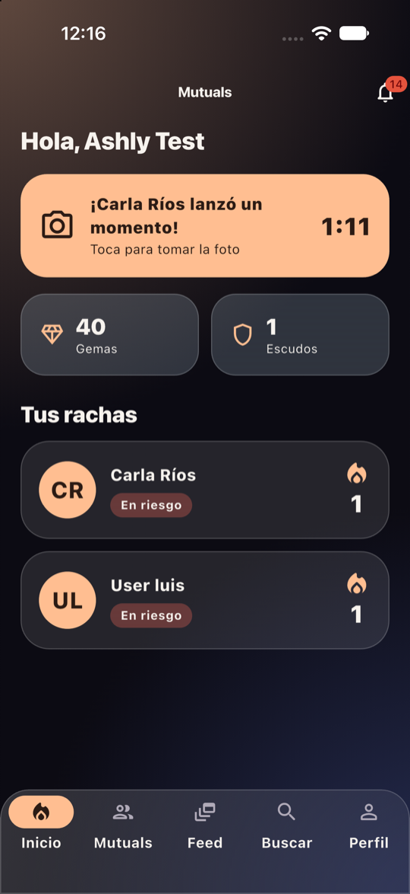
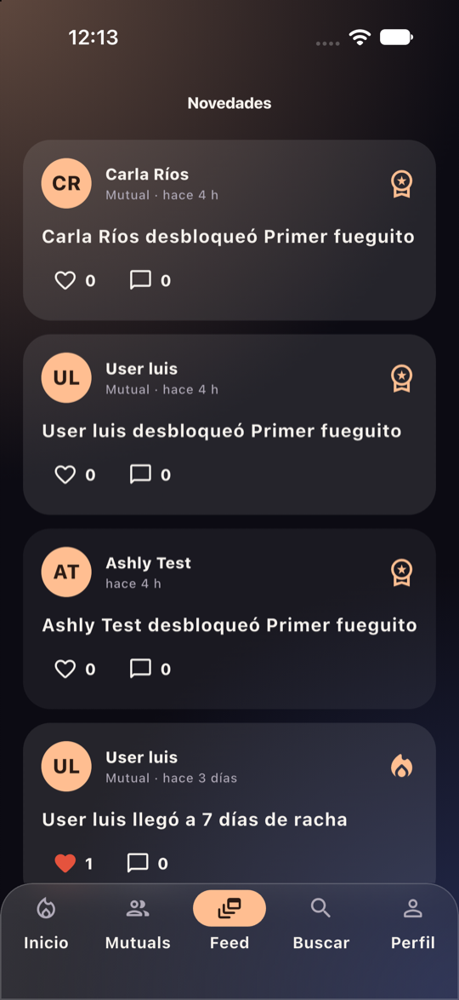
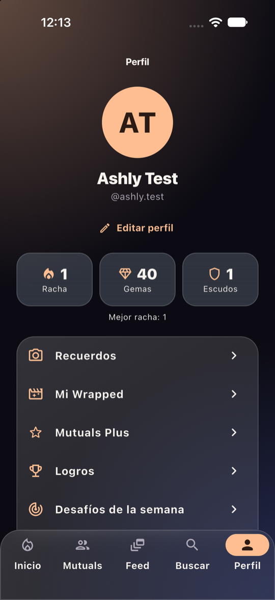
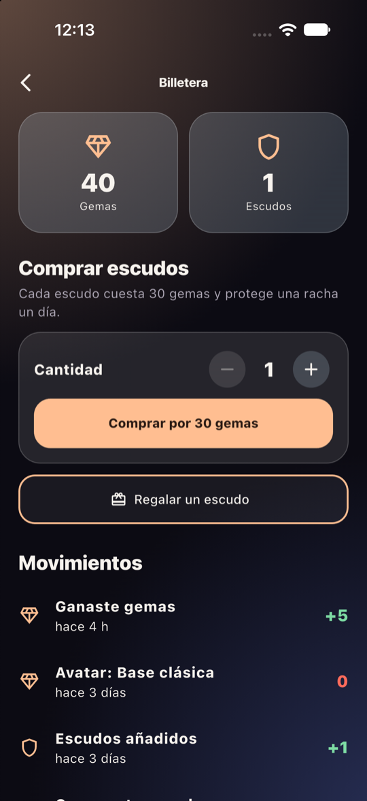
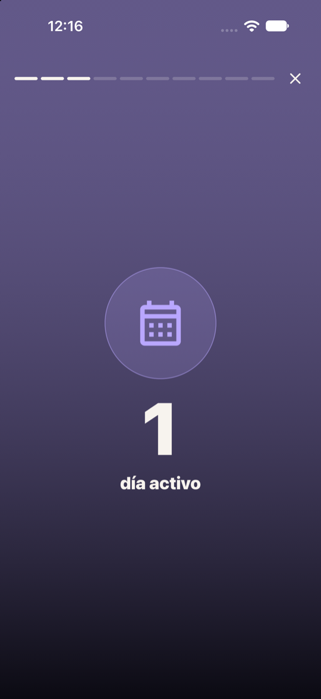
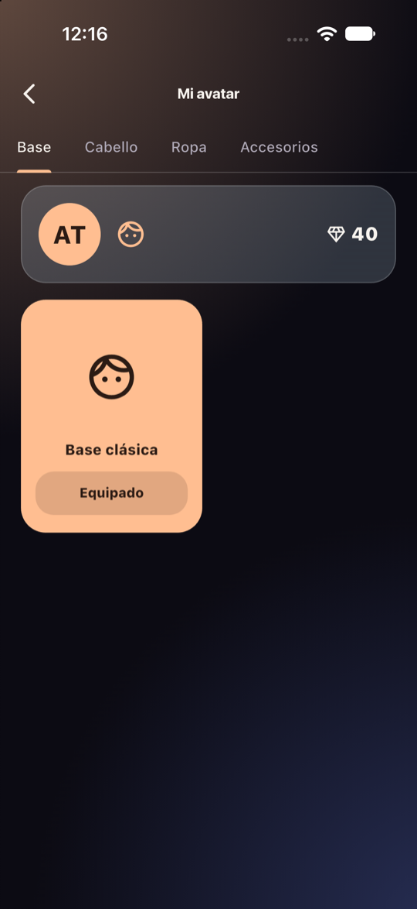
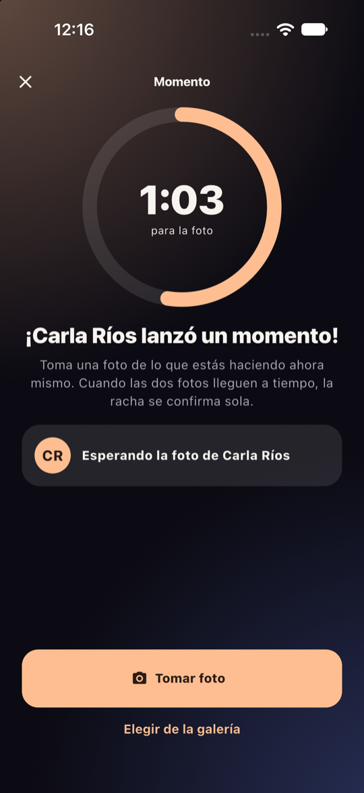

# Mutuals Mobile

[](https://github.com/MutualsConnect/mutuals-mobile/actions/workflows/ci.yml)

App móvil de **Mutuals**, la red social de rachas que solo cuentan cuando los amigos de verdad se ven o hablan
(QR, cercanía o confirmación mutua). Es el cliente móvil (Flutter) de la API REST de Spring Boot del proyecto
([mutuals-backend](https://github.com/MutualsConnect/mutuals-backend)), desarrollada y probada en **iPhone**.

Curso CS2031 Desarrollo Basado en Plataformas, UTEC 2026-2.

**API desplegada (backend en AWS):** <http://3.144.115.104> · Swagger: <http://3.144.115.104/swagger-ui.html>
**Frontend web:** <https://mutuals-web.vercel.app> ([mutuals-web](https://github.com/MutualsConnect/mutuals-web))

Las redes sociales miden la amistad con seguidores y "me gusta", pero ninguna dice si de verdad seguimos en contacto.
En Mutuals dos amigos mantienen una **racha diaria que ambos confirman**: por confirmación manual, por un código QR
que cambia cada 30 segundos o por proximidad con GPS.

| Inicio | Feed | Perfil |
| :---: | :---: | :---: |
|  |  |  |

| Billetera | Wrapped | Avatar |
| :---: | :---: | :---: |
|  |  |  |

| Momento de foto |
| :---: |
|  |

## Integrantes y participación

| Integrante | Código | Principales aportes | Participación |
|---|---|---|---|
| Ashly Nicole Veliz Barba | 202210422 | App móvil completa en Flutter, desarrollada y probada en iPhone: estructura del proyecto, cliente HTTP con JWT y renovación automática de tokens, autenticación (incluido el inicio de sesión con Google), rachas e invitaciones, interacciones (confirmación manual, QR rotativo y proximidad por GPS), momentos de foto y Recuerdos, perfil y social (seguidores, bloqueos y reportes), billetera y escudos, desafíos, logros, tienda de avatar, feed, notificaciones, ajustes y privacidad, Mutuals Plus, Wrapped y pruebas. Diseño visual (modo oscuro con efecto vidrio), que se usó también en la web. En el backend: momentos de foto. | 100 % |
| Oriana Manuela Fe Manrique Romero | 202320149 | Frontend web completo en React ([mutuals-web](https://github.com/MutualsConnect/mutuals-web)). En el backend: login con Google. | 100 % |

## Stack

- **Flutter** 3.47 y **Dart**, con Material 3 en **modo oscuro con efecto vidrio** (superficies translúcidas con desenfoque sobre un fondo con resplandores durazno y celeste) e iconos monocromáticos en lugar de emojis
- **Riverpod** para el estado
- **go_router** para la navegación, con barra inferior y rutas protegidas por sesión
- **dio** para HTTP, con un interceptor que renueva el JWT ante un 401 sin duplicar renovaciones
- **flutter_secure_storage** (Keychain / Keystore) para los tokens
- **mobile_scanner** y **qr_flutter** para el QR, **geolocator** para la proximidad, **image_picker** para las fotos
- **google_sign_in** para el inicio de sesión con Google
- **flutter_lints**, **flutter_launcher_icons** y **flutter_native_splash** para lint, ícono y pantalla de inicio

## Funcionalidades

Cubre las funciones principales de la API del backend (el panel de administración vive en la web).

| Módulo | Qué hace la app |
|---|---|
| Cuenta | Registro, inicio de sesión (correo o **Google**), recuperar y restablecer la contraseña con el código del correo, sesión que se restaura sola y renovación automática de tokens |
| Social | Buscar personas, seguir, dejar de seguir (con aviso si hay una racha activa), perfil público con sus logros, **seguidores y siguiendo**, lista de mutuals, editar tu perfil, bloquear (con lista de **usuarios bloqueados**) y reportar |
| Rachas | Invitaciones (enviar, aceptar, rechazar, cancelar), rachas activas en el inicio, detalle con contador animado, escudos e historial |
| Interacciones | Confirmación manual con nota, **código QR rotativo** (mostrar y escanear), **proximidad por GPS** y **momentos de foto**; confirmar o rechazar lo que registran tus amigos, e **historial de interacciones** |
| Momentos de foto | Una persona lanza un momento y las dos tienen 2 minutos para tomar una foto de lo que hacen; al llegar ambas, la racha se confirma sola y se revelan las fotos juntas. Los momentos completados quedan en **Recuerdos** |
| Ajustes y perfil | Preferencias de notificaciones y privacidad (al activar la ubicación se envía tu posición para detectar mutuals cerca), dispositivos registrados, **personalizar** tema, fuego e ícono (Plus) y eliminar la cuenta |
| Notificaciones | Lista paginada con filtro de importantes, contador de no leídas en la campana y acceso directo a cada pantalla |
| Economía | Billetera de gemas y escudos, compra de escudos, regalos a mutuals e historial |
| Gamificación | Logros, tienda de avatar por capas y desafíos semanales (texto y foto) |
| Feed | Novedades de tus mutuals con me gusta y comentarios (solo entre mutuals) |
| Wrapped y Plus | Resumen mensual, anual e histórico en formato de historias; suscripción a Mutuals Plus |

## Arquitectura

Organizada **por funcionalidad**, igual que el backend:

```
lib/
├── core/        tema, router, cliente HTTP, almacenamiento seguro, ubicación y utilidades
├── shared/      widgets reutilizables (botones, avatar, estados vacíos y de error)
└── features/    un módulo por dominio:
    auth/  social/  streaks/  interactions/  moments/  notifications/  economy/
    gamification/  activity/  wrapped/  subscription/  home/  shell/  splash/
      ├── data/          modelos y repositorio (llamadas a la API)
      ├── application/   controladores de estado (cuando hacen falta)
      └── presentation/  pantallas y widgets
```

Cada módulo de `features/` tiene su **repositorio** (llamadas a la API), sus **controladores** (estado con Riverpod) y
su **presentación** (UI), así las pantallas solo combinan piezas.

### Errores y feedback

- Cada repositorio traduce los errores de la API a una `ApiException` con el mensaje del servidor y los errores por
  campo, de modo que las pantallas solo muestran el texto.
- El interceptor de `dio` renueva el JWT ante un 401 sin duplicar renovaciones.
- Widgets compartidos para los estados vacíos y de error (`lib/shared/widgets`).

## Cómo correrlo

Requisitos: Flutter 3.47+ y Xcode (simulador de iPhone) o Android Studio. Para el backend: Java 21, Maven y Docker Desktop.

**1. Levantar el backend** (en la carpeta de [mutuals-backend](https://github.com/MutualsConnect/mutuals-backend)):

```bash
cp .env.example .env              # primera vez; cambia JWT_SECRET y QR_SECRET
docker compose up -d db mail      # PostgreSQL y Mailpit (correos de prueba en http://localhost:8025)
mvn spring-boot:run               # API en http://localhost:8080
```

**2. Ejecutar la app:**

```bash
flutter pub get
flutter run
```

La app apunta por defecto a `http://localhost:8080/api/v1` (en el emulador de Android usa `10.0.2.2`). Para usar otro
servidor se pasa la URL al compilar:

```bash
flutter run --dart-define=API_URL=https://tu-servidor/api/v1
```

| Variable (`--dart-define`) | Descripción |
|---|---|
| `API_URL` | URL de la API, por ejemplo `http://localhost:8080/api/v1` |
| `GOOGLE_SERVER_CLIENT_ID` | OAuth Client ID (aplicación web) de Google Cloud, el mismo que `GOOGLE_CLIENT_ID` del backend. Sin él no aparece el botón de Google |
| `GOOGLE_IOS_CLIENT_ID` | OAuth Client ID de tipo iOS para el inicio de sesión con Google en iPhone |

> La API desplegada en AWS usa **HTTP**, y la app para iOS solo permite HTTP hacia la red local (App Transport
> Security). Para usar el servidor de AWS desde la app haría falta ponerle HTTPS; por eso la app se prueba contra el
> backend local.

### En un iPhone real

El iPhone y la computadora deben estar en la **misma red wifi**. Conecta el teléfono, desbloquéalo y toca «Confiar»;
luego usa la IP de tu computadora (en Mac: `ipconfig getifaddr en0`) y su id (`flutter devices`):

```bash
flutter run -d <id-del-iphone> --dart-define=API_URL=http://<IP-DE-TU-MAC>:8080/api/v1
```

La primera vez hay que abrir `ios/Runner.xcworkspace` en Xcode y elegir tu equipo de desarrollo y un
identificador propio en *Signing & Capabilities*; esos ajustes son personales y no se suben al repositorio.

### Iniciar sesión con Google

El botón «Continuar con Google» solo aparece si se compila con el Client ID de Google Cloud:

```bash
flutter run --dart-define=GOOGLE_SERVER_CLIENT_ID=xxxx.apps.googleusercontent.com \
            --dart-define=GOOGLE_IOS_CLIENT_ID=yyyy.apps.googleusercontent.com
```

En iOS además hay que registrar el esquema de URL invertido del Client ID de iOS en `ios/Runner/Info.plist`.

### Restablecer la contraseña

En «¿Olvidaste tu contraseña?» se pide el correo; el código llega a la bandeja (en desarrollo, a Mailpit en
`http://localhost:8025`). Con «Ya tengo el código» se pega el código y se elige la nueva contraseña.

> En desarrollo se permite HTTP hacia el backend local. Para publicar la app hay que usar HTTPS.

Otros comandos: `flutter analyze` y `flutter test`.

## Pruebas

```bash
flutter analyze
flutter test                    # pruebas de pantallas y lógica, sin red
MUTUALS_E2E=1 flutter test test/integration/backend_smoke_test.dart
```

- **125 pruebas** de pantallas y lógica con repositorios simulados.
- **31 pruebas de integración** contra el backend real (opcionales): registro, rachas, interacciones por QR y
  proximidad, momentos de foto, notificaciones, billetera, desafíos, feed, Wrapped, Plus, perfil, bloqueos y reportes.
  Requieren el backend en `localhost:8080` y el contenedor de PostgreSQL del `docker-compose` del backend.
- GitHub Actions ejecuta el análisis y las pruebas en cada push y pull request.

## Estado y límites conocidos

- **Momentos de foto:** requieren el backend con el endpoint `/moments`. Sin push, la otra persona ve el aviso
  **cuando tiene la app abierta** (se consulta cada pocos segundos). La cámara real solo se prueba en un teléfono; en
  el simulador se usa la galería.
- **Notificaciones push (Firebase):** pendientes; requieren el proyecto de Firebase del equipo
  (`google-services.json`, `GoogleService-Info.plist` y la cuenta de servicio del backend). Las notificaciones dentro
  de la app funcionan completas.
- **Suscripción Plus:** es una demostración, igual que en el backend; no se realiza ningún cobro.
- **Tema:** la app es siempre oscura (con vidrio); no tiene modo claro.
- **Android:** el proyecto está configurado (permisos, ícono y pantalla de inicio), pero las pruebas visuales se
  hicieron en iPhone.
- El backend aún no entrega imágenes para los ítems de avatar, así que se representan con emojis.
- **Pendiente en la app:** cambiar la foto de perfil (el backend aún no tiene endpoint para subirla), el Wrapped
  por periodo, de plataforma y por amigo, y el inicio de sesión con Google en iOS hasta contar con los Client ID.

## Repositorios

| Parte | Repositorio |
|---|---|
| Backend (Java, Spring Boot) | [mutuals-backend](https://github.com/MutualsConnect/mutuals-backend) |
| Web (React) | [mutuals-web](https://github.com/MutualsConnect/mutuals-web) |
| **Mobile (Flutter)** | este repositorio |

El backend es un fork de [inkarrime/mutuals](https://github.com/inkarrime/mutuals), que conserva el historial y los
commits del equipo original.
