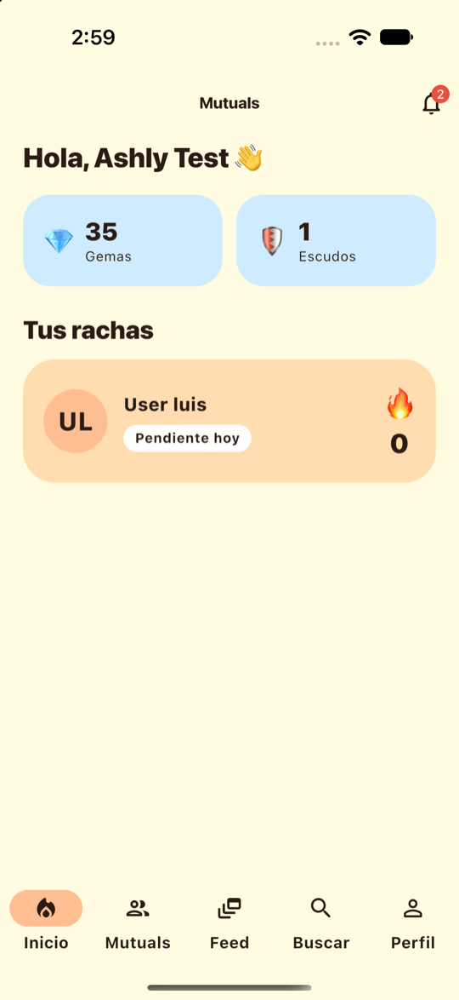
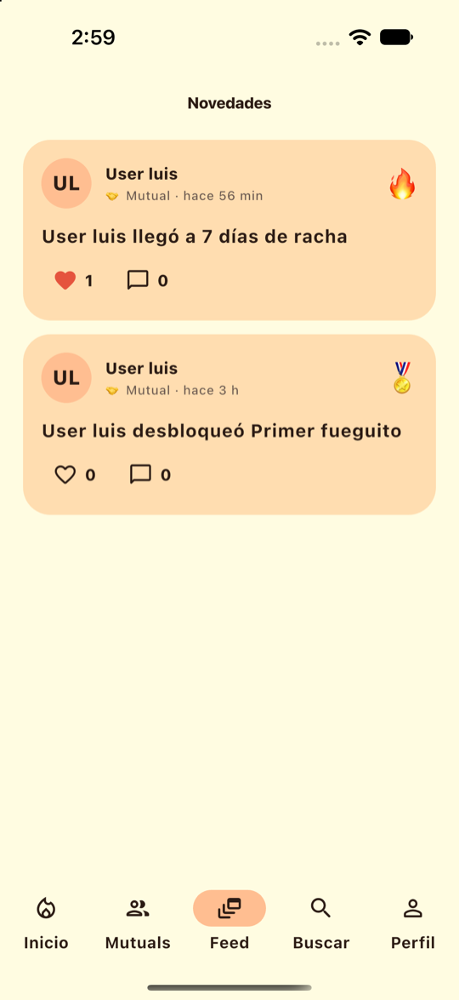
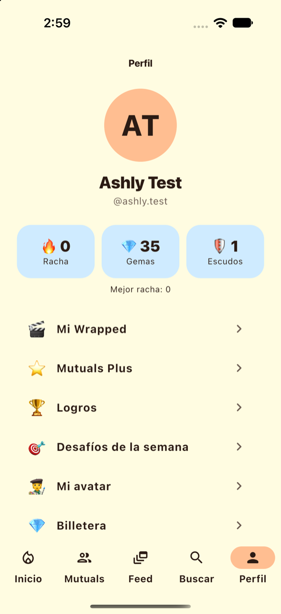
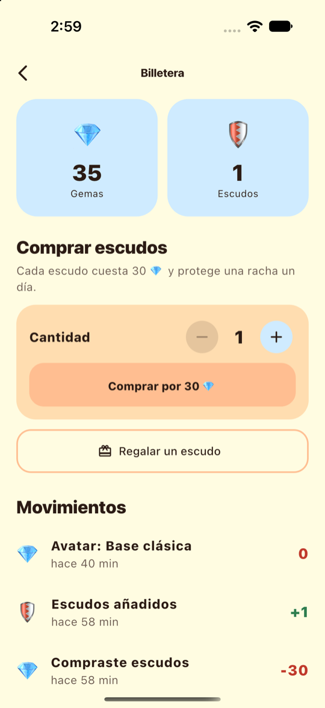
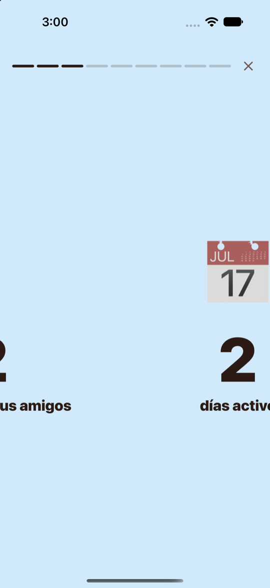
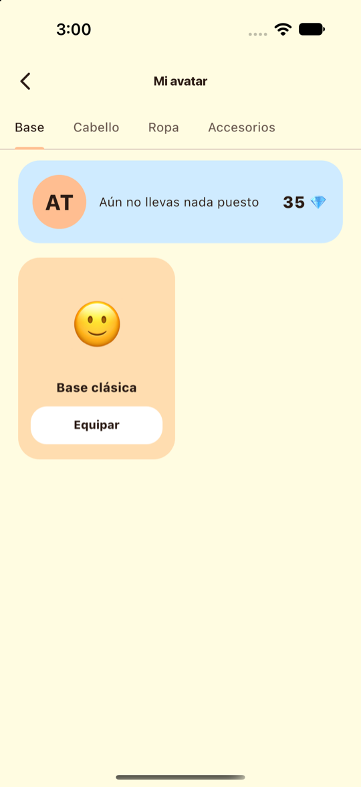

# Mutuals Mobile

[](https://github.com/MutualsConnect/mutuals-mobile/actions/workflows/ci.yml)

App móvil de **Mutuals**: rachas verificadas para mantener amistades reales.
Proyecto del curso **CS 2031 Desarrollo Basado en Plataforma** · UTEC · Ciclo 2026-2.

Las redes sociales miden la amistad con seguidores y "me gusta", pero ninguna dice si de verdad seguimos en contacto.
En Mutuals dos amigos mantienen una **racha diaria que ambos confirman**: por confirmación manual, por un código QR
que cambia cada 30 segundos o por proximidad con GPS. Esta app es el cliente móvil (Flutter) de la API REST del proyecto.

| Inicio | Feed | Perfil |
| :---: | :---: | :---: |
|  |  |  |

| Billetera | Wrapped | Avatar |
| :---: | :---: | :---: |
|  |  |  |

## Funcionalidades

Cubre las funciones principales de la API del backend (el panel de administración vive en la web).

| Área | Qué hace la app |
| --- | --- |
| **Cuenta** | Registro, inicio de sesión, recuperar contraseña, sesión que se restaura sola y renovación automática de tokens |
| **Social** | Buscar personas, seguir, dejar de seguir (con aviso si hay una racha activa), perfil público, lista de mutuals, editar tu perfil, bloquear y reportar |
| **Rachas** | Invitaciones (enviar, aceptar, rechazar, cancelar), rachas activas en el inicio, detalle con contador animado, escudos e historial |
| **Interacciones** | Confirmación manual con nota, **código QR rotativo** (mostrar y escanear) y **proximidad por GPS**; confirmar o rechazar lo que registran tus amigos |
| **Notificaciones** | Lista paginada con filtro de importantes, contador de no leídas en la campana y acceso directo a cada pantalla |
| **Economía** | Billetera de gemas y escudos, compra de escudos, regalos a mutuals e historial |
| **Gamificación** | Logros, tienda de avatar por capas y desafíos semanales (texto y foto) |
| **Feed** | Novedades de tus mutuals con me gusta y comentarios (solo entre mutuals) |
| **Wrapped y Plus** | Resumen mensual, anual e histórico en formato de historias; suscripción a Mutuals Plus |

## Tecnologías

- **Flutter** 3.47 y Dart, con Material 3 y una paleta propia (durazno, crema y celeste).
- **Riverpod** para el estado, **go_router** para la navegación (con barra inferior y rutas protegidas por sesión).
- **dio** para HTTP, con un interceptor que renueva el JWT ante un 401 sin duplicar renovaciones.
- **flutter_secure_storage** (Keychain / Keystore) para los tokens.
- **mobile_scanner** y **qr_flutter** (QR), **geolocator** (proximidad), **image_picker** (fotos de desafíos).

## Arquitectura

Organizada **por funcionalidad**, igual que el backend:

```
lib/
  core/        # tema, router, cliente HTTP, almacenamiento seguro, ubicación, utilidades
  shared/      # widgets reutilizables (botones, avatar, estados vacíos y de error)
  features/
    auth/  social/  streaks/  interactions/  notifications/
    economy/  gamification/  activity/  wrapped/  subscription/  home/  shell/
      data/          # modelos y repositorio (llamadas a la API)
      application/   # controladores de estado (cuando hacen falta)
      presentation/  # pantallas y widgets
```

Cada repositorio traduce los errores de la API a una `ApiException` con el mensaje del servidor y los errores por
campo, de modo que las pantallas solo muestran el texto.

## Ejecutar

Requisitos: Flutter 3.47+, y Xcode (simulador de iPhone) o Android Studio.

```bash
flutter pub get
flutter run
```

La app apunta por defecto a `http://localhost:8080/api/v1` (en el emulador de Android usa `10.0.2.2`). Para usar otro
servidor, por ejemplo el desplegado en AWS:

```bash
flutter run --dart-define=API_URL=https://tu-servidor/api/v1
```

El backend se levanta con Docker y Maven; las instrucciones están en el README de
[mutuals-backend](https://github.com/MutualsConnect/mutuals-backend).

> En desarrollo se permite HTTP hacia el backend local. Para publicar la app hay que usar HTTPS.

## Pruebas

```bash
flutter analyze
flutter test                    # pruebas de pantallas y lógica, sin red
MUTUALS_E2E=1 flutter test test/integration/backend_smoke_test.dart
```

- **88 pruebas** de pantallas y lógica con repositorios simulados.
- **28 pruebas de integración** contra el backend real (opcionales): registro, rachas, interacciones por QR y
  proximidad, notificaciones, billetera, desafíos, feed, Wrapped, Plus, perfil, bloqueos y reportes. Requieren el backend en `localhost:8080`
  y el contenedor de PostgreSQL del `docker-compose` del backend.
- GitHub Actions ejecuta el análisis y las pruebas en cada push y pull request.

## Estado y límites conocidos

- **Notificaciones push (Firebase):** pendientes; requieren el proyecto de Firebase del equipo
  (`google-services.json`, `GoogleService-Info.plist` y la cuenta de servicio del backend). Las notificaciones dentro
  de la app funcionan completas.
- **Suscripción Plus:** es una demostración, igual que en el backend; no se realiza ningún cobro.
- **Modo oscuro:** el diseño es claro y cálido; la app no sigue el modo oscuro del sistema.
- **Android:** el proyecto está configurado (permisos, ícono y pantalla de inicio), pero las pruebas visuales se
  hicieron en el simulador de iPhone.
- El backend aún no entrega imágenes para los ítems de avatar, así que se representan con emojis.
- **Pendiente en la app:** preferencias y dispositivos, personalización del perfil con temas (Plus), eliminar la cuenta y
  cambiar la foto de perfil. Restablecer la contraseña se completa desde el enlace del correo.

## Autoría y repositorios

El proyecto es de **Mutuals**, un equipo de tres personas. Cada repositorio conserva el historial de commits de quien
hizo el trabajo.

| Parte | Repositorio | Autoría |
| --- | --- | --- |
| Backend (Java, Spring Boot) | [mutuals-backend](https://github.com/MutualsConnect/mutuals-backend) | Jhanpiere Montes, Ashly Veliz y Oriana Manrique |
| Web (React) | `mutuals-web` | Oriana Manrique |
| **Mobile (Flutter)** | este repositorio | **Ashly Veliz** |

El backend es un fork de [inkarrime/mutuals](https://github.com/inkarrime/mutuals), que conserva el historial y los
commits de todo el equipo original.

### Integrantes

| Integrante | Código |
| --- | --- |
| Oriana Manuela Fe Manrique Romero | 202320149 |
| Ashly Nicole Veliz Barba | 202210422 |
| Jhanpiere Alejandro Montes Quispe | 202210413 |

**Curso:** CS 2031 Desarrollo Basado en Plataforma · **Profesor:** Jorge Villavicencio Antunez
